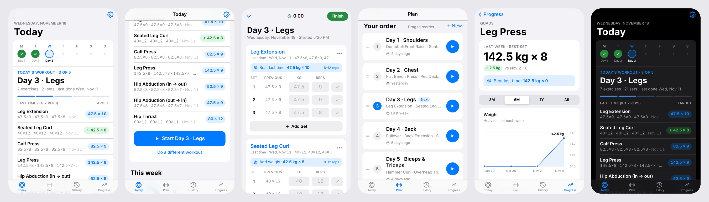

# Lift: a simple workout tracker for iPhone

A clean, Apple-style gym log that you install on your iPhone's Home Screen. It
remembers the weight and reps of every set and shows them **week by week**, so you
can always see whether you're progressing and know exactly what to beat next time.



It's a Progressive Web App: plain HTML/CSS/JavaScript with no build step, no
account and no server. Your data stays on your phone.

## Your day in the gym

1. **Open Lift.** The **Today** tab shows the next workout in your order
   (Day 1 → Day 2 → … → Day 5 → Day 1). Each exercise shows the weight × reps of
   every set from the last time you did that day, plus today's **target**.
2. **Tap Start.** Every set is pre-filled with last session's numbers. Tap ✓ if you
   matched them, or type what you actually did.
3. **Tap Finish.** Today's sets are saved and become the **baseline for next
   time**. Everything is kept forever in History and Progress.

Train as many days a week as you like (4 one week, 6 the next). Lift doesn't care
about weekdays in this mode: it always picks the workout after the last one you
finished. If you'd rather tie workouts to weekdays, switch **Plan → How you train**
to **Fixed days**. Then a missed day is offered as a catch-up on your next free day.

## Your program (preloaded)

| Day | Exercises |
|---|---|
| **Day 1 · Shoulders** | Dumbbell Front Raise · Seated Dumbbell Press · Cable Face Pull |
| **Day 2 · Chest** | Flat Bench Press · Pec Deck · Incline Bench Press |
| **Day 3 · Legs** | Leg Extension · Seated Leg Curl · Calf Press · Leg Press · Hip Abduction (in → out) · Hip Adduction (out → in) · Hip Thrust |
| **Day 4 · Back** | Pullover · Back Extension · Seated Cable Row · Machine Row |
| **Day 5 · Biceps & Triceps** | Hammer Curl · Overhead Triceps Extension · Dumbbell Curl · Triceps Rope Pushdown |

Every exercise starts at 3 sets × 8–12 reps. Change sets, rep ranges, exercises or
order in **Plan**, and rename any exercise in **Settings → Exercises** (its history
stays attached).

## What it does

| Tab | What you get |
|---|---|
| **Today** | The next workout with last time's sets and today's targets, where you are in your order (e.g. 3 of 5), a week strip of the days you trained, a ring for workouts vs. your weekly goal, your streak, workouts per week, and recent records. |
| **Plan** | **How you train**: *In order* (numbered list, drag to reorder) or *Fixed days* (tap a weekday to pick a workout). Each exercise in a workout has sets and a **rep range** (e.g. 8–12). Other ready-made programs (Push/Pull/Legs, Upper/Lower, Full Body) are available too. |
| **History** | Every workout grouped by week, with duration, sets and record count. Open one to see each set compared with the previous session. Edit it, delete it, or do it again. |
| **Progress** | Every exercise you've trained, with its latest top set, change vs. the previous week, and a trend line. Each exercise has its own page with a **weight** chart and a **reps** chart (same weeks), your personal bests, and a **week-by-week log of every set's weight × reps**. |

While you train:

- The **Previous** column shows last session's sets (from the same day of your program), and empty fields are pre-filled with them.
- Each exercise shows a target using **double progression** (below).
- When you lift heavier than ever, or do more reps than ever with a weight you've used before, you get a **🏆 record** right away.
- A **rest timer** starts after each set (adjustable, or turn it off in Settings).
- Swipe a set left to delete it. Minimize the workout to browse your history while it keeps running.
- kg or lb, weeks starting Monday or Sunday, and light/dark mode that follows your iPhone.
- **Backups**: Settings → Export Backup saves a `.json` file to Files/iCloud Drive. Restore it on any device.

## How targets work

No formulas, just weight and reps:

- **Beat last time:** one more rep than your best set last time, at the same weight.
- **Add weight:** when every set reaches the top of the exercise's rep range (12
  by default), the target becomes the next weight up (+2.5 kg / +5 lb) at the
  bottom of the range (8).

## Put it on your iPhone

See **[INSTALL.md](INSTALL.md)** for step-by-step instructions (about 5 minutes).

## Run it on your computer

Any static file server works:

```sh
python3 -m http.server 8000
# then open http://localhost:8000
```

## Project layout

```
index.html              App shell
manifest.webmanifest    Home Screen name, icons, colors
sw.js                   Offline cache (bump VERSION when you change files)
css/app.css             iOS-style design system, light + dark
js/app.js               Router, navigation bar, tab bar
js/store.js             Data model + localStorage persistence (weights stored in kg)
js/stats.js             Weekly stats, records, targets, today's workout
js/workout.js           Live workout logger, rest timer, finish summary
js/picker.js            Exercise picker / new exercise
js/charts.js            SVG line chart (scrubbable), columns, sparklines, rings
js/views/*.js           Today, Plan/Routines, History, Progress, Settings
js/data.js              Exercise library, starter programs (schedule + rep ranges)
icons/                  App icons
```

### Updating the app

After changing any file, bump `VERSION` in `sw.js` (e.g. `lift-v4` → `lift-v5`) and push. The
installed app updates in the background and shows the new version the next time
you open it.
